# EDA de la instancia qap10 (Track A: vuelos → puertas)

Resumen del notebook **`notebooks/01_data.ipynb`**, que contiene el análisis completo con código, tablas y gráficos. Para
regenerarlo (rehace también las figuras y las tablas): `uv run jupyter nbconvert --to notebook --execute --inplace notebooks/01_data.ipynb`.
Las figuras están en `docs/figures/` y las tablas en `docs/eda/*.csv`. En figuras y tablas los vuelos se llaman **V1..V10** y las puertas **P1..P10**
(en el código van de 0 a 9). Paleta de las figuras: Okabe-Ito (azul, bermellón, verde azulado), validada para daltonismo.
**Las unidades son supuestos, no mediciones.**

## 1. Perfil de los datos

La instancia son dos matrices pequeñas y completas: no hay nulos, ni duplicados, ni valores raros.

| Dato | Valor |
|---|---|
| Vuelos × puertas | 10 × 10 |
| Pares de vuelos | 45 (cada par se cuenta una sola vez) |
| Pares con flujo > 0 | **29 (64,4 %)**; 16 pares sin pasajeros en común |
| Flujo total | 228 |
| Valores de flujo (pares > 0) | 2, 4, 6, 8, 10, 12, 20; mediana 8; **todos pares (mcd = 2)** |
| Distancias entre puertas | 1 a 5; media 2,24; D simétrica, diagonal cero |
| Layout de las puertas | **Cuadrícula de 4 columnas**, 10 celdas; D = distancia Manhattan (verificado celda a celda) |

| Flujo del par | 0 | 2 | 4 | 6 | 8 | 10 | 12 | 20 |
|---|---|---|---|---|---|---|---|---|
| Número de pares | 16 | 4 | 9 | 1 | 2 | 9 | 1 | 3 |

| Distancia entre puertas | 1 | 2 | 3 | 4 | 5 |
|---|---|---|---|---|---|
| Pares de puertas | 13 | 15 | 11 | 5 | 1 |

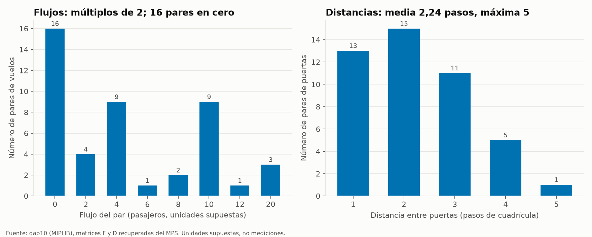

**Lectura.** Los flujos son pocos valores discretos (18 de los 29 pares con flujo valen 4 o 10, y tres pares excepcionales valen 20); como
`mcd = 2`, el dato "real" son los múltiplos 1, 2, 3, 4, 5, 6 y 10 (el factor 2 viene de la escala del archivo MPS). Más de la
mitad de los pares de puertas están a 1 o 2 pasos.

## 2. Patrones en los flujos

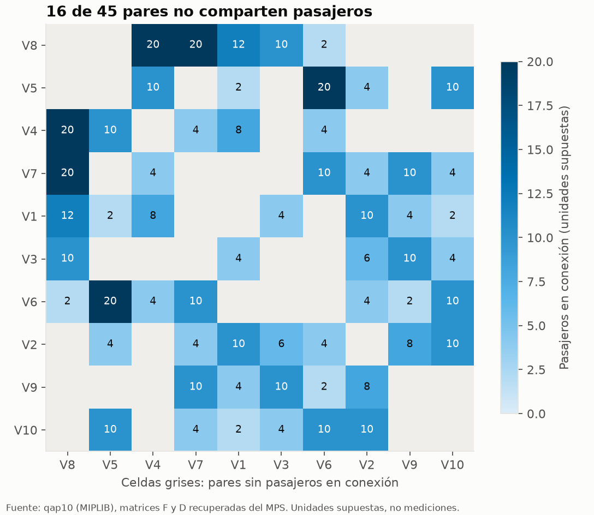

| Vuelo | Socios | Pasajeros en conexión | Participación | Mayor flujo (con) |
|---|---|---|---|---|
| **V8** | 5 | **64** | 14,0 % | 20 (V4) |
| V6 | 7 | 52 | 11,4 % | 20 (V5) |
| V7 | 6 | 52 | 11,4 % | 20 (V8) |
| V2 | 7 | 46 | 10,1 % | 10 (V1) |
| V4 | 5 | 46 | 10,1 % | 20 (V8) |
| V5 | 5 | 46 | 10,1 % | 20 (V6) |
| V1 | 7 | 42 | 9,2 % | 12 (V8) |
| V10 | 6 | 40 | 8,8 % | 10 (V2) |
| V3 | 5 | 34 | 7,5 % | 10 (V8) |
| V9 | 5 | 34 | 7,5 % | 10 (V3) |

"Participación" = pasajeros del vuelo / (2 × flujo total); suma 100 % porque cada transbordo involucra dos vuelos.

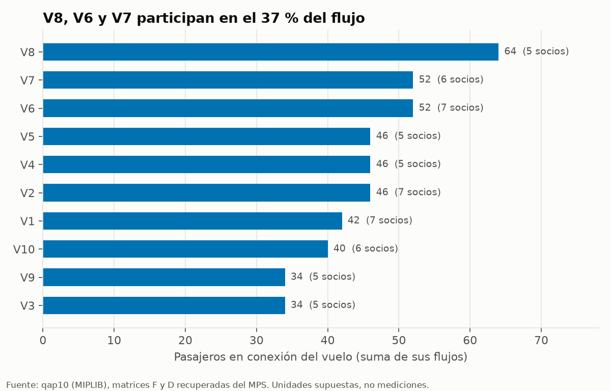

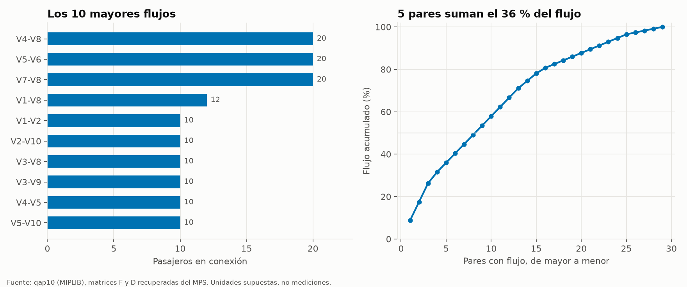

**Hallazgos.**
- **V8 es el vuelo hub:** 64 pasajeros, y tres de sus cinco socios son de los flujos grandes (V4 y V7 con 20, V1 con 12).
- **Los flujos no están muy concentrados:** los tres pares de 20 (V4–V8, V5–V6, V7–V8) suman 26,3 %; los 5 mayores, 36 %; los 10 mayores, 58 %. No basta con "juntar los tres pares grandes": hay una cola larga de 10 y 4 que también cuenta.
- Hay 16 pares de vuelos sin pasajeros en común, así que el problema no es un grafo completo (densidad 0,64).

## 3. Las puertas

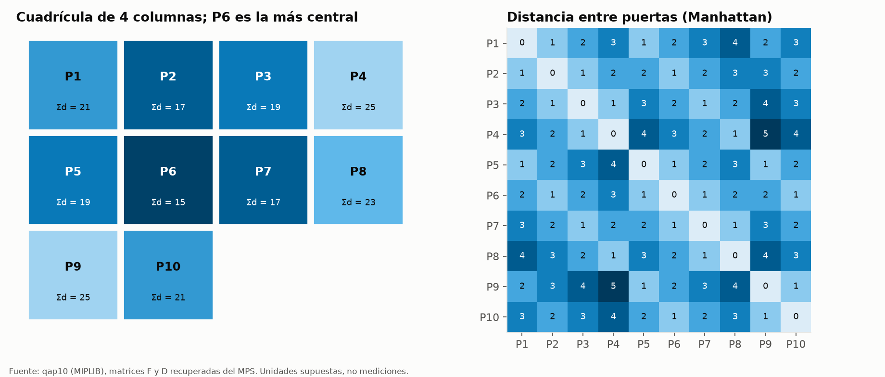

| Puerta | P6 | P2, P7 | P3, P5 | P1, P10 | P8 | P4, P9 |
|---|---|---|---|---|---|---|
| Suma de distancias al resto (menor = más central) | **15** | 17 | 19 | 21 | 23 | 25 |

**P6 es la puerta más central** y P4 / P9 son las más periféricas (las dos esquinas más alejadas, a 5 pasos entre sí).
Como el costo premia la cercanía, la centralidad de la puerta importa para los vuelos con más pasajeros.

## 4. El paisaje del costo (exacto sobre las 3 628 800 permutaciones)

Se enumeraron todas las asignaciones (unos segundos), así que estas cifras no son una muestra.

| Medida | Valor |
|---|---|
| **Óptimo** | **340, con una única permutación** (`V1→P3 V2→P7 V3→P4 V4→P1 V5→P9 V6→P5 V7→P6 V8→P2 V9→P8 V10→P10`) |
| Segundo mejor costo | 346 (+1,8 %), también una sola permutación |
| Asignaciones con gap ≤ 1 % / 5 % / 10 % / 20 % | 1 / 6 / 207 / 11 939 |
| Costo medio (exacto) · desv. estándar · mediana · máximo | 511,7 · 39,2 · 512 · 666 |
| Asignación identidad (V*i* → P*i*) | 454 (gap 33,5 %); solo el 6,8 % de las asignaciones son mejores |
| Ahorro del óptimo frente al promedio aleatorio (1 − 340/511,7; **no es un gap**) | **33,6 %** |
| Simetrías de D (permutaciones de puertas que preservan las distancias) | 1, solo la identidad |

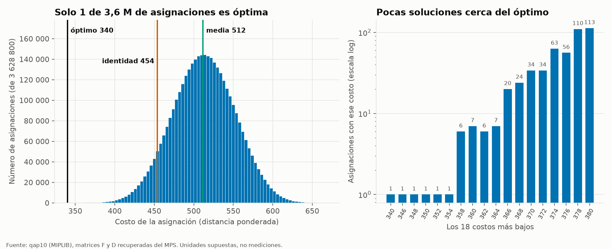

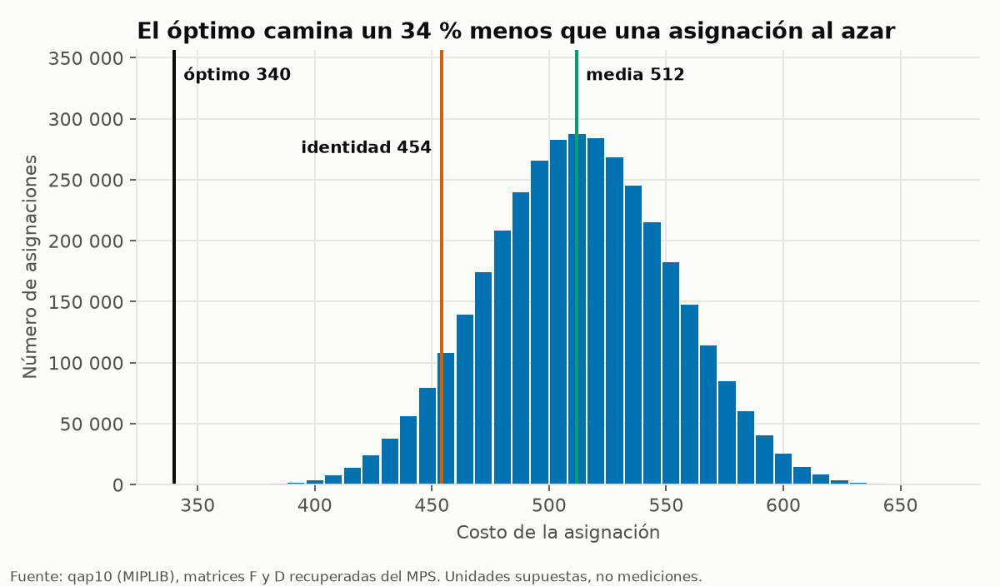

**Hallazgos.**
- **Es una aguja en un pajar:** el óptimo es único y la distribución es casi una campana (media 512, desviación 39); el óptimo está a 4,4 desviaciones de la media.
- **No hay soluciones gemelas:** D no tiene simetrías, así que no existen óptimos equivalentes por reflexión. Esto simplifica la verificación (basta comparar con una sola permutación).
- **La identidad ya es buena (454):** solo el 6,8 % de las asignaciones la mejora, lo que sugiere que el orden de los vuelos en el archivo no es arbitrario; por eso "ahorro vs identidad" (25 %) es una cifra más modesta que "ahorro vs azar" (34 %). Para la historia, **usar "frente a una asignación al azar" y decirlo explícitamente**.
- Los costos son siempre pares (F es par); la separación mínima entre niveles de costo es 2.

### Brecha (gap) con la fórmula del reto

El enunciado pide, para la instancia completa, calcular la brecha **solo sobre soluciones válidas**:

$$\text{gap}(\%) = 100\,\frac{C - 340}{340}$$

Todas las asignaciones de esta sección son válidas (una puerta por vuelo y un vuelo por puerta), así que la fórmula aplica a todas.

| Solución de referencia | Costo | Gap |
|---|---|---|
| Óptimo | 340 | 0 % |
| Segundo mejor | 346 | 1,76 % |
| Óptimo local medio (búsqueda por intercambios, sección 6) | 372,9 | 9,7 % |
| Identidad (V*i* → P*i*) | 454 | 33,5 % |
| Media de una asignación al azar | 511,7 | 50,5 % |
| Peor asignación | 666 | 95,9 % |

**Gap no es lo mismo que ahorro.** El gap mide cuánto peor que el óptimo es una solución (relativo a 340). El "ahorro" de la
narrativa mide cuánto menos camina el óptimo frente a una referencia (relativo a esa referencia): 1 − 340/511,7 = **33,6 %** frente
al azar. La asignación al azar tiene gap 50,5 %, y la identidad tiene gap 33,5 %, casi el mismo número que el ahorro. **En el pitch
y en las diapositivas hay que nombrar siempre cuál de las dos cifras se muestra.** Para los métodos cuánticos, las muestras
inválidas se excluyen del gap y se reportan aparte como fracción factible.

## 5. Cómo es la solución óptima

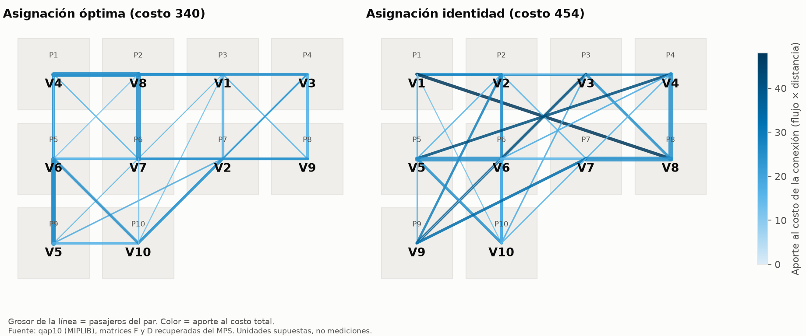

| Distancia que caminan los pasajeros entre sus dos puertas | 1 paso | 2 pasos | 3 pasos | ≥4 pasos |
|---|---|---|---|---|
| Óptima | **59,6 %** | 34,2 % | 3,5 % | 2,6 % |
| Identidad | 44,7 % | 25,4 % | 15,8 % | 14,0 % |
| Aleatoria (esperada) | 28,9 % | 33,3 % | 24,4 % | 13,3 % |

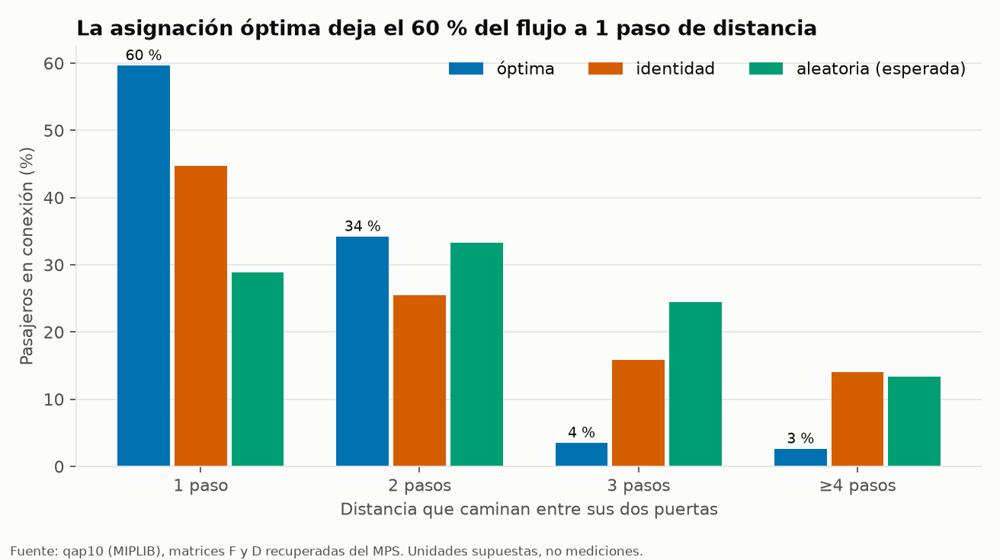

- Distancia media por pasajero: **1,49 pasos** (óptima), 1,99 (identidad), 2,24 (azar).
- **Los vuelos con más pasajeros tienden a ocupar puertas más centrales:** correlación de Spearman −0,70 entre pasajeros del vuelo y
  distancia media de su puerta (n = 10, p ≈ 0,02; evidencia moderada, no concluyente). V8 (64) está en P2, la segunda más central, pegada a
  sus socios V4 (P1) y V1 (P3); V7 (52) está en P6, la más central.
- No es una regla simple: V5 (46) queda en P9 (periférica) porque su socio principal V6 está en P5, a 1 paso. **Lo que se optimiza es la
  cercanía entre socios, no la centralidad por sí sola.**

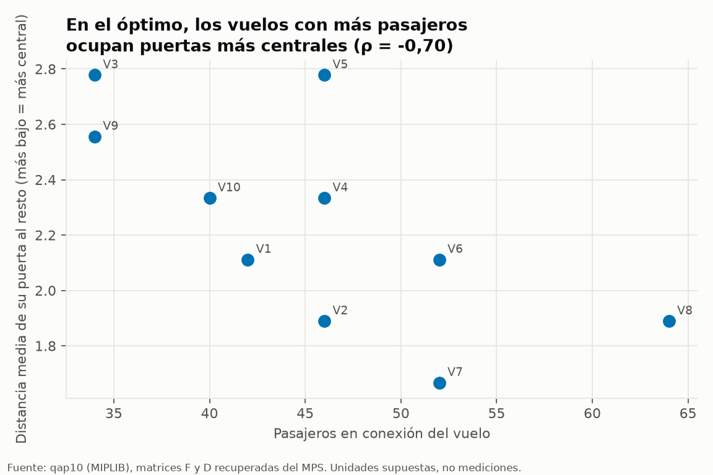

## 6. Dificultad para los métodos de búsqueda

2 000 descensos por intercambios de pares desde permutaciones aleatorias (semilla 0):

| Medida | Valor |
|---|---|
| Óptimos locales distintos alcanzados | 274 |
| Arranques que terminan en el óptimo global | **3,2 %** |
| Arranques que terminan con gap ≤ 5 % | 9,9 % |
| Costo medio de un óptimo local · peor | 372,9 (gap 9,7 %) · 428 (gap 25,9 %) |
| Pasos hasta converger | 4,6 en promedio |

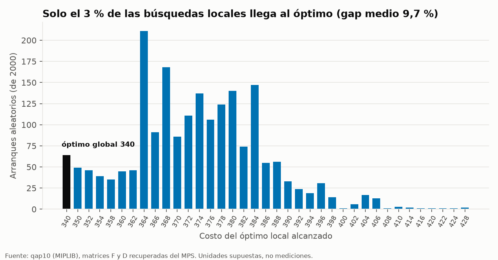

**Implicación (para Rodrigo y Diego):** el paisaje es rugoso. Una búsqueda local simple casi nunca llega al óptimo (3 de cada 100) pero
cae casi siempre a ~10 % de él, y converge en pocos pasos. Por eso el recocido simulado con reinicios (D5) es la línea base correcta, y
para el híbrido conviene vecindarios que **no sean solo intercambios de pares** (por ejemplo, reasignar k = 3 o 4 vuelos a la vez, como en M6).

## 7. Tamaño del problema y su efecto en lo cuántico

| N | Pares con flujo | Óptimo | Media aleatoria | Ahorro vs azar | Qubits (N²) | Fracción de bitstrings factibles |
|---|---|---|---|---|---|---|
| 3 | 3 | 24 | 26,7 | **10 %** | 9 | 1,17 % |
| 4 | 4 | 32 | 46,7 | 31 % | 16 | 0,037 % |
| 5 | 7 | 58 | 88,0 | 34 % | 25 | 0,00036 % |
| 6 | 10 | 94 | 139,2 | 33 % | 36 | 1,0·10⁻⁸ |
| 7 | 13 | 112 | 171,4 | 35 % | 49 | 9,0·10⁻¹² |
| 8 | 18 | 214 | 308,0 | 31 % | 64 | 2,2·10⁻¹⁵ |
| 9 | 23 | 264 | 417,8 | 37 % | 81 | 1,5·10⁻¹⁹ |
| 10 | 29 | 340 | 511,7 | 34 % | 100 | 2,9·10⁻²⁴ |

Memoria de un statevector completo: N=4 → 1 MiB, N=5 → 512 MiB, N=6 → 1 TiB (coincide con la tabla del enunciado).

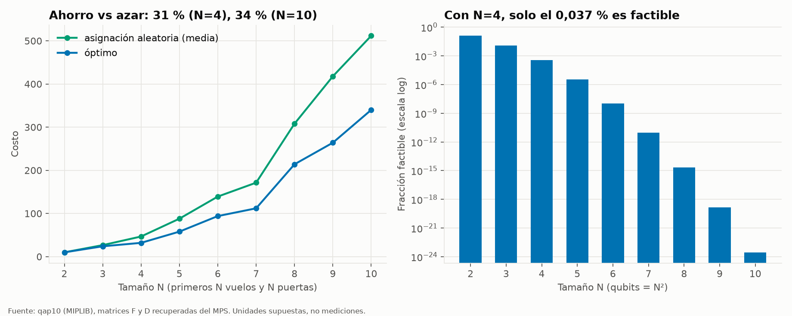

**Hallazgos.**
- **N=3 es demasiado fácil para una demo:** el óptimo ahorra solo 10 % frente al azar y hay apenas 6 permutaciones. **N=4 ya muestra
  un ahorro del 31 %**, parecido al de la instancia completa (31–37 % desde N=4). Recomendación: **N=4 como instancia principal de la demo
  cuántica** y N=3 como prueba rápida.
- **Con la codificación one-hot, casi todos los bitstrings son inválidos:** con N=4 solo 24 de 65 536 (0,037 %) son asignaciones. Elegir
  bitstrings al azar daría una asignación válida 1 de cada ~2 700 veces; cualquier método cuántico tiene que superar ese piso. Eso hace
  que **la fracción factible y la penalización λ sean el eje técnico del estudio** (tarea M4 de Diego).
- Con N=3 y N=4 solo hay 6 y 24 permutaciones: conviene reportar el **costo recalculado, la factibilidad y si se alcanzó el óptimo exacto**, no solo el porcentaje de brecha.
- **Gap en subinstancias:** el reto define el gap para la instancia completa (referencia 340). Para N=3 y N=4 usamos la misma
  fórmula con el óptimo de control de esa subinstancia (24 y 32); es una extensión nuestra y hay que decirlo al reportarla.

## 8. Escala del QUBO

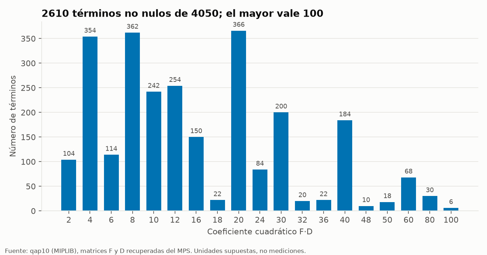

El objetivo tiene 4 050 términos F·D (45 pares de vuelos × 90 pares ordenados de puertas), **2 610 no nulos**, con valores de 2 a 100
(19 valores distintos; el 100 es F=20 × D=5). Cualquier penalización λ debe ser comparable con estos coeficientes (del orden de
decenas); se calcula con precisión en la tarea M4.

## 9. La instancia en Qiskit

El método cuántico se construye con **Qiskit**. El notebook representa cada subinstancia como `QuadraticProgram`
(`qiskit-optimization`), la convierte a QUBO con penalizaciones (`QuadraticProgramToQubo`) y a Hamiltoniano de Ising (`to_ising`,
con x = (1 − Z)/2), y verifica que las tres representaciones dan **exactamente el mismo costo** que `qap.types.cost` sobre
asignaciones válidas.

| N | Qubits | Términos de Pauli | λ automático de Qiskit | Mayor coeficiente del objetivo | Asignaciones verificadas | Costo idéntico |
|---|---|---|---|---|---|---|
| 3 | 9 | 45 | 161 | 20 | 6 (todas) | sí |
| 4 | 16 | 112 | 561 | 30 | 24 (todas) | sí |
| 5 | 25 | 265 | 1 761 | 40 | 120 (todas) | sí |
| 6 | 36 | 516 | 4 177 | 80 | 720 (todas) | sí |
| 10 | 100 | 3 610 | 46 057 | 100 | 202 (óptimo, identidad y 200 al azar) | sí |

- Sobre una asignación válida la penalización vale 0, así que **energía = costo**. En una inválida la energía incluye la
  penalización y **no** es un costo; por eso el gap se calcula solo sobre válidas.
- Los términos de Pauli crecen rápido: además del objetivo, cada restricción one-hot aporta un término ZZ por cada par de
  variables de su fila o columna.
- **La penalización automática de Qiskit es muy grande** (561 con N=4, cuyo mayor coeficiente es 30). Garantiza que el mínimo sea
  factible, pero aplana el paisaje de energía: elegir un λ menor y justificado es parte de la tarea M4.

## 10. Calidad de datos

| Chequeo | Resultado |
|---|---|
| Nulos / valores faltantes | Ninguno |
| Dimensiones y tipos | Dos matrices 10×10 de enteros ≥ 0 |
| Simetría | D simétrica con diagonal cero; F se guarda triangular superior (cada par una vez) |
| Estructura de D | Igual a la distancia Manhattan sobre una cuadrícula de 4 columnas (celda a celda) |
| Rank-1 de los coeficientes del MPS | Verificado para los 45 bloques (F·D exacto) |
| Reproducción de los óptimos de control | 24 (N=3), 32 (N=4), 340 (N=10) por búsqueda exhaustiva |
| Representación en Qiskit | `QuadraticProgram`, QUBO e Ising reproducen el costo exacto (N = 3, 4, 5, 6, 10) |
| Sentido físico | Distancias y flujos sin unidades en el archivo: **supuestos, no mediciones** |

## 11. Qué hacer con esto

| Para quién | Recomendación |
|---|---|
| **Felipe (historia)** | Usar "34 % menos caminata que una asignación al azar" (exacto: 33,6 %) y llamarlo **ahorro**, no gap; mostrar `flow_by_distance.png` (60 % del flujo a 1 paso) y `optimal_assignment.png`. Decir "al azar", no "frente al orden actual". Demo cuántica en N=4. |
| **Diego (modelos)** | Partir de la representación Qiskit verificada (sección 9). La fracción factible one-hot (0,037 % en N=4) y el λ automático (561 frente a un coeficiente máximo de 30) enmarcan el estudio de λ. Reportar costo recalculado, factibilidad, gap solo sobre muestras válidas y si se llegó al óptimo exacto. |
| **Rodrigo (datos)** | SA con reinicios como línea base (los descensos simples llegan al óptimo solo el 3 %, con gap medio 9,7 %). Benchmark con N = 3, 4, 5 y 10 y la columna gap con la fórmula del reto. |
| **Todos** | El óptimo es único (D no tiene simetrías): comparar contra una sola permutación. |

## Limitaciones de este análisis

Es una sola instancia (qap10), de tamaño pequeño; la correlación hub–centralidad usa 10 puntos. Las estadísticas de búsqueda local dependen
del vecindario (intercambios de pares) y de la semilla 0. Las unidades son supuestos: los porcentajes son relativos y reproducibles, pero no
equivalen a minutos ni metros reales.
